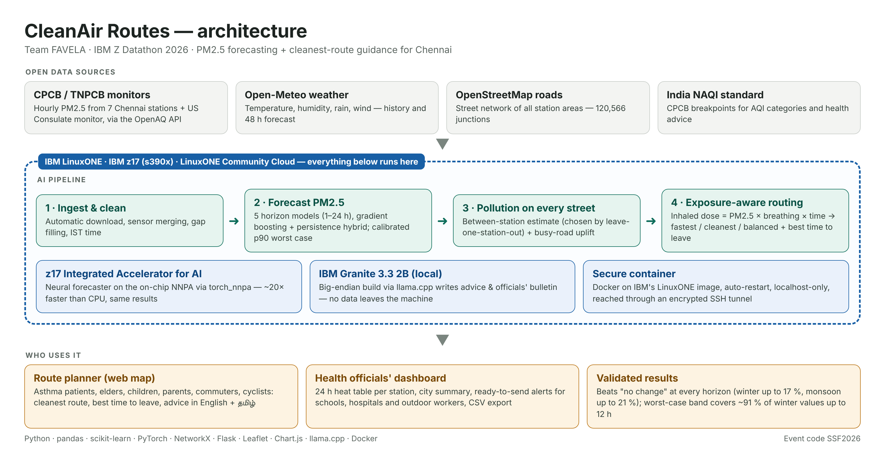

# CleanAir Routes — Chennai PM2.5 forecast + cleanest-route guidance

**Live demo:** open `index.html` from this repository's GitHub Pages link.

**Demo video:** https://youtu.be/gsfDoFJA_Lc?si=RjLi06b3wdfg2z8_

Forecasts PM2.5 at Chennai's monitoring stations for the next 24 hours and plans walking or cycling routes that
minimise the pollution you breathe in, with advice for asthma patients, elders and children (English and Tamil),
plus a dashboard with ready-to-send alerts for health officials.

Built and trained on **IBM LinuxONE (IBM z17, s390x)** for the IBM Z Datathon 2026 by Team FAVELA.
This public demo replays real data from the held-out winter test period, which the model never trained on:
forecasts and alerts were computed with the same code (rebuilt off-mainframe for this public demo) and exported; routing runs live in your browser.

Full source code, model results and the LinuxONE notebook: https://github.com/meranjith28/FAVELA-CleanAir-Routes-IBMZ-Datathon-2026
